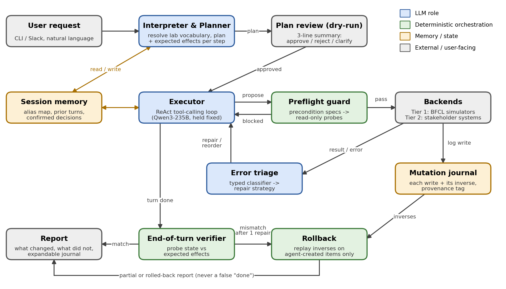

# Steward: reliable execution of irreversible multi-step operations

CSE 598 Agentic AI capstone. This repository holds the project plan, the measured baseline and
the code needed to reproduce it, and will hold the Steward agent as it is built.

**Status:** Milestone 1 (discovery) complete. The refined scope, design and evaluation plan below
were reviewed with the stakeholder on October 1, 2026. Next: Milestone 2, the first prototype.

Steward is an agent that carries out multi-step operations on a team's working systems from a
natural language request, across files, tickets, and messaging. Because those operations are
irreversible, the development loop runs offline against BFCL V4 multi-turn, which executes an
agent's tool calls against stateful simulated backends and compares the resulting state with ground
truth over 200 tasks.

| | |
|---|---|
| Baseline | Stock BFCL V4 multi-turn agent loop, no scaffolding |
| Model | `qwen3-235b-a22b-instruct-2507`, Prompt mode, OpenAI-compatible endpoint |
| Deployment slice | **42.11%** (16/38 cases: filesystem, tickets, messaging) |
| All backends | **55.50%** (111/200) |
| Held-out backends | **65.22%** (60/92: travel, vehicle, trading, social) |
| Single-turn reference | 90.94% on function selection, for contrast |

The model selects the right functions but does not sequence them safely against changing state.
Among failing runs that touch a single backend, 83% of tool errors are precondition or ordering
violations.

---

## Team and stakeholder

| Role | Name |
|---|---|
| Team | Kunal Jadhav, Siddanagouda Patil, Saniya Rajesh Nande, Siddhesh More, Yuvraj Rasal |
| Stakeholder | Shreya Kale |
| Discovery meeting | October 1, 2026 |

---

## Milestone 1: refined scope

**User -** The lab member who owns operational work: consolidating run directories before a
scratch purge, working the compute-request ticket queue, and posting status updates. Labmates
phrase requests in lab vocabulary ("the March runs"), not in paths and ticket IDs.

**Input -** A multi-turn natural language request, the current state of the target systems
(visible only through read tools), and the file, ticket and messaging tool schemas.

**Output -** A dry-run plan of at most three lines, expandable to the full step list; after
approval, the executed tool calls; and a report of what actually changed, including partial
completion and anything rolled back.

**In scope -** The *ops trio* of BFCL backends (`GorillaFileSystem`, `TicketAPI`, `MessageAPI`) as
the deployment target, with the other four backends held out to test generalization. The CLI is
the primary interface.

**Out of scope -** Deleting pre-existing data, fine-tuning the model, and the BFCL `web_search` and
`memory` categories. The Slack bot is now a stretch goal.

**Failure, most severe first -** an unintended change to pre-existing data; reporting "done" while
the state is wrong; leftover residue from abandoned steps; doing nothing, or guessing, when it
should have acted or asked.

## Stakeholder feedback and what it changed

| Feedback | Change to the project |
|---|---|
| Deletion is never acceptable; archiving is fine | Rollback may remove only items Steward created in the same session, identified by a provenance tag in the journal |
| A reported wrong move is far better than an unreported one | Silent wrong success is a co-primary metric, target 5% or below |
| Will not read a 40-line plan | Plans are summarized in at most three lines, with an expand option |
| Refuse and ask rather than guess | Added a clarify action; evaluation now includes `multi_turn_miss_param` and `multi_turn_miss_func` |
| Requests use lab vocabulary | Added entity resolution and a session alias memory |
| Wrong twice on real data and they stop using it | Zero unintended mutations is a hard acceptance gate; dry-run is the default |
| CLI first, Slack is nice to have | Slack bot moved to a stretch goal |

---

## Planned architecture



One model (`qwen3-235b-a22b-instruct-2507`, held fixed) plays the planner, executor and triage
roles. Deterministic components check its work:

| Component | Role |
|---|---|
| Interpreter & Planner | Resolves lab vocabulary to entities, asks when a reference is ambiguous, writes a plan with the expected effect of each step |
| Executor | Tool-calling loop over the unchanged BFCL tool schemas |
| Preflight guard | Before each mutating call, checks its preconditions with read-only probes; runs irreversible calls (close ticket, send message) last |
| Error triage | Classifies tool errors (missing path, bad argument, unmet precondition, auth, transient) and applies a matching repair |
| Mutation journal | Records every write with its inverse and whether Steward created the item |
| End-of-turn verifier | Runs in a fresh context; compares the probed state with the expected effects |
| Rollback | On an unrepaired mismatch, applies the inverses in reverse order to items Steward created |

Steward will be implemented as a custom BFCL model handler, so the unmodified BFCL evaluator scores
it exactly as it scores the baseline.

## Baselines

| System | Description |
|---|---|
| **B0** | The stock BFCL multi-turn loop in this repository (primary baseline) |
| **B1** | Single call, open loop: the model writes each turn's full call sequence in one call, and it executes with no feedback |
| **B2** | B0 plus naive retry: errors are fed back with "try again", up to twice |

## Evaluation targets

Agreed with the stakeholder. All figures are reported over three seeds, with paired McNemar tests
against B0 and B2.

| Metric | Baseline (B0) | Target |
|---|---|---|
| Task completion, ops trio | 42.11% (16/38) | 60% or above |
| Task completion, all 200 `base` tasks | 55.50% (111/200) | 65% or above |
| Task completion, held-out backends | 65.22% (60/92) | 70% or above, no regression |
| State-corruption failures | 66 of 89 | 40 or fewer |
| Silent wrong success | to instrument | 5% or below |
| Tool-call error rate | 16.3% (300/1,841) | 10% or below |
| Recovery rate after a tool error | 49.5% (54/109) | 70% or above |
| Cost (tool calls per task) | 9.2 | within 1.5x of B0 |

**Stakeholder acceptance -** Run on a mirrored sandbox of the stakeholder's directory tree, dry-run
first. Zero unintended mutations is a hard gate. Also required: at least 8 of 10 real requests
completed, and at least 9 of 10 plans approved without the stakeholder asking what a step does.

## Next steps

- [ ] Complete B0 on `miss_func`, `miss_param` and `long_context`, three seeds each
- [ ] Instrument silent wrong success
- [ ] Implement baselines B1 and B2
- [ ] Implement the preflight guard and the end-of-turn verifier (neither changes prompts)
- [ ] Receive the mirrored directory listing and ten example requests from the stakeholder

---

## Quick start

### Path A: reproduce the baseline offline, no API key

```bash
python3 analyze_failures.py
```

Runs in under a second against committed run artifacts. Requires Python 3.8 or later and nothing
else: no install, no key, no network. This is the fastest way to verify the reported figures.

### Path B: run the baseline live

```bash
./setup.sh
# add QWEN_API_KEY to gorilla/berkeley-function-call-leaderboard/.env
python3 run_baseline.py --limit 20
```

Requires an endpoint key, so see "Getting endpoint access" below first. A measured 20-case run took
6.2 minutes at ten threads. Runtime varies with endpoint load.

---

## Getting endpoint access

The baseline runs against ASU Research Computing's Voyager service, which is free for ASU students
and staff. Reference: <https://docs.rc.asu.edu/ai/api/>.

### 1. Connect to the ASU VPN

Research Computing resources, including the Voyager portal, require the ASU VPN when you are off
campus.

1. Install the Cisco Secure Client, formerly Cisco AnyConnect, from <https://sslvpn.asu.edu> or
   through ASU MyApps.
2. Launch it and enter the VPN address `sslvpn.asu.edu/2fa`.
3. Sign in with your ASU ID and password, then complete two-factor authentication through Duo Push,
   a phone call, or a passcode.

Reference: <https://docs.rc.asu.edu/sslvpn/>.

### 2. Create a Voyager API key

1. Open <https://voyager.rc.asu.edu> and sign in with your ASU credentials.
2. Select the **LLM Access** tab.
3. Click **Create Key** and copy the token, which is shown once.
4. Check **Available Models** for the current model list, context windows, and usage. Any `id`
   listed there is valid as the `model` value.

If a key is exposed, regenerate it in the portal. Rotating a key invalidates the old one. Keys
belong in the `.env` file described below, which `.gitignore` excludes from version control.

The model used for the baseline is `qwen3-235b-a22b-instruct-2507`. If it is unavailable on your
account, any model in the portal list will run, but the reported scores apply only to that model.

---

## Configuration

`setup.sh` writes a starter `.env` into the BFCL checkout at
`gorilla/berkeley-function-call-leaderboard/.env`. Fill in the key:

```bash
QWEN_API_KEY=<your-key>
QWEN_BASE_URL=https://openai.rc.asu.edu/v1
```

| Variable | Required | Purpose |
|---|---|---|
| `QWEN_API_KEY` | Path B | Model endpoint key |
| `QWEN_BASE_URL` | Path B | Endpoint URL. Defaults to Alibaba DashScope if unset, so it must be set |
| `BFCL_HOME` | no | Path to the BFCL checkout, if not the default sibling location |

The endpoint is OpenAI-compatible, so any other OpenAI-compatible provider works by changing
`QWEN_BASE_URL`. Scores will differ if the model differs.

---

## What the baseline does

`run_baseline.py` drives the unmodified BFCL multi-turn loop:

1. Select a slice of `multi_turn_base`, 20 cases by default, and write it to BFCL's `--run-ids` file.
2. Instantiate the stateful simulated backends each case requires, with defined initial state. BFCL
   provides seven: filesystem, travel, ticketing, vehicle control, messaging, trading, and social.
3. Replay a multi-turn conversation. At each turn the model receives the tool schemas and the
   history so far and emits function calls.
4. Execute those calls against live backend state, returning genuine results and errors to the model.
5. After the final turn, serialize backend state and compare it with ground truth.

Step 5 grades the resulting state of the system rather than the text of the call, which is the
property under study and is uncommon among public benchmarks. No agent framework, retry logic, or
recovery logic is used, since the object of measurement is the unassisted model loop. Work built on
this baseline should hold the model fixed so that gains are attributable to the agent design.

---

## Files

| Path | Purpose |
|---|---|
| `run_baseline.py` | Live baseline runner: generate, evaluate, report |
| `analyze_failures.py` | Offline scorer and failure taxonomy, no API key required |
| `setup.sh` | Clone BFCL at the pinned commit, create venv, install, patch, scaffold `.env` |
| `baseline/cached/*.json.gz` | Full 200-case run artifacts, scores and traces |
| `baseline/cached/data_*.csv` | Score tables in the official BFCL format |
| `patches/qwen_vllm_fix.patch` | Handler fixes required for vLLM-served endpoints |
| `examples/multi_turn_20.json` | The default 20-case slice |
| `.env.example` | Template for the two required environment variables |
| `docs/milestone-1/architecture.png` | Planned Steward architecture (Milestone 1) |

**Input:** the BFCL dataset, installed with `bfcl_eval`, with no separate download.
**Output:** `<bfcl-root>/capstone_run/result/` for raw traces and `capstone_run/score/` for scores.
Runs write only beneath `capstone_run/`, so they cannot overwrite the committed artifacts.

---

## Commands

```bash
# Reproduce the full 200-case baseline offline (under a second, no key)
python3 analyze_failures.py

# Inspect one failing case in detail
python3 analyze_failures.py --case multi_turn_base_2

# Live runs
python3 run_baseline.py --limit 20        # 20 cases
python3 run_baseline.py --limit 5         # smoke test
python3 run_baseline.py --threads 4       # lower concurrency if the endpoint returns 5xx
python3 run_baseline.py --analyze-only    # re-score an existing run

# Analyze a run produced by run_baseline.py
python3 analyze_failures.py --score <bfcl-root>/capstone_run/score/<model>/multi_turn/BFCL_v4_multi_turn_base_score.json
```

`analyze_failures.py` locates the result file matching a given score file automatically. It skips
the trace-based sections rather than pairing files from different runs.

---

## Expected output

`python3 analyze_failures.py` reports the baseline, a per-backend and per-slice breakdown, the
failure taxonomy, tool-error rates for passing and failing runs, and the precondition analysis:

```
========================================================================
BFCL V4  multi_turn_base  BASELINE
========================================================================
  accuracy  : 55.50%   (111/200 cases passed)
  failures  : 89

0. BASELINE BY WORKLOAD
      GorillaFileSystem       25/ 50 passed = 50.00%
      VehicleControlAPI       30/ 50 passed = 60.00%
      TradingBot              35/ 50 passed = 70.00%
      TravelAPI               21/ 50 passed = 42.00%
      MessageAPI              22/ 40 passed = 55.00%
      TwitterAPI              24/ 39 passed = 61.54%
      TicketAPI               10/ 31 passed = 32.26%

      ops trio (deployment)   16/ 38 passed = 42.11%
      held-out (4 backends)   60/ 92 passed = 65.22%
      all backends           111/200 passed = 55.50%

1. FAILURE TYPE
    66  (74.2%)  instance_state_mismatch
    16  (18.0%)  execution_response_mismatch
     7  ( 7.9%)  empty_turn_model_response

3. TOOL-CALL ERROR RATE  (failed vs passed runs)
  FAILED:  89 cases |   62% hit >=1 tool error |  188/ 950 calls errored (19.8%)
  PASSED: 111 cases |   49% hit >=1 tool error |  112/ 891 calls errored (12.6%)

5. IS THE FAILURE DOMAIN-SPECIFIC?  (single-backend failing cases)
  GorillaFileSystem     44/ 56 errors are precondition ( 79%)
  VehicleControlAPI     13/ 14 errors are precondition ( 93%)
  TravelAPI              7/  7 errors are precondition (100%)
  overall: 64/77 = 83%
```

Two observations that shape the project. First, roughly half of passing runs also hit tool errors
and recovered, so errors alone do not cause failure and the differentiator is recovery quality.
Second, the dominant error is a precondition violation in every backend alike, which is why the
reliability mechanisms are designed to be backend-agnostic.

### Worked failure: `multi_turn_base_2`

```bash
python3 analyze_failures.py --case multi_turn_base_2
```

The conversation asks for `TeamNotes.txt` to be created inside `documents/`, appended to, compared
with `ideas.txt`, and copied to the archive. The model called `cd document`, a typographical error,
received `{"error": "cd: 'document': No such file or directory"}`, and created the file in the root
directory anyway. It later navigated correctly and created the file in the intended location, but
never removed the first one. The final tree holds the file in two places where one was requested,
and the agent would have reported success. Detection and repair both functioned; compensation did
not.

---

## Known limitations

- **Runs are not deterministic.** The Qwen handler sends no `temperature`, so server default
  sampling applies. Expect variation of about two percentage points on the full set and considerably
  more on small slices. A live 20-case run and the cached artifacts both scored 50.00% on the same
  slice but failed a different set of cases. Small slices confirm that the pipeline runs; they do
  not reproduce the 200-case figures. Use Path A for those.
- **Runtime varies with endpoint load.** A 20-case run took 6.2 minutes at ten threads, while a
  3-case run took 7.8 minutes on a different occasion. Individual cases execute 30 to 65 tool calls
  sequentially, so the slowest case gates the run regardless of thread count.
- **The Qwen handler requires patching for vLLM-served endpoints.** Upstream targets Alibaba
  DashScope and fails on zero-argument tool calls and on streaming usage accounting. `setup.sh`
  applies `patches/qwen_vllm_fix.patch`.
- **`generate_with_backoff` performs no retry** despite its name, so transient endpoint errors can
  end a case mid-conversation. Lower `--threads` if this occurs.
- **The `web_search` and `memory` categories are excluded.** Their search quota requirements exceed
  the free tier.
- **BFCL's backends are simulations.** They model neither permissions, quotas, rate limits, nor
  concurrent writers, so benchmark results overstate reliability in deployment.

---

## Troubleshooting

| Symptom | Fix |
|---|---|
| `could not find the BFCL checkout` | Run `./setup.sh`, or set `BFCL_HOME` |
| `ModuleNotFoundError: soundfile` | `pip install soundfile`; `qwen-agent` imports it without declaring it |
| `QWEN_API_KEY is not set` | Add it to `<bfcl-root>/.env` |
| Python version rejected | BFCL requires 3.10 or later; `uv venv --python 3.11` |
| Repeated 5xx errors mid-run | Lower `--threads`, for example to 4 |
| Requests reach DashScope, not your endpoint | `QWEN_BASE_URL` is unset and defaulted |
| Connection timeouts reaching `openai.rc.asu.edu` | Connect to the ASU VPN at `sslvpn.asu.edu/2fa` |
| `401` or `403` from the endpoint | Key is wrong or rotated; create a new one in the Voyager portal |
